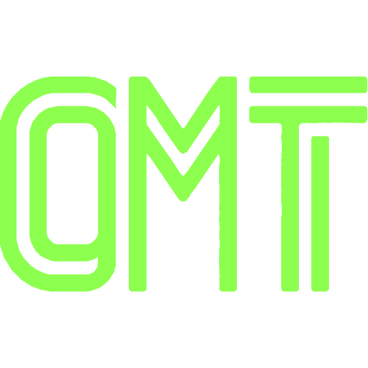

<p align="center">
  
</p>

# oh-my-thinkrail

A fork of [ThinkRail](https://github.com/JetBrains/thinkrail), adapted for the **Tomato workflow** and
issue-centered development collaboration.

The goal is to use **GitHub and GitLab Issues as durable records of key session decisions and
summaries**, so people and agents can resume work without depending on a single chat history or
machine. Issues capture goals, design decisions, progress, verification results, and handoffs—not full
chat transcripts or private reasoning.

This fork explores more efficient ways to collaborate across design, implementation, and review,
while retaining ThinkRail's [pi](https://www.npmjs.com/package/@earendil-works/pi-coding-agent)-based
sessions and isolated Git worktrees.

## Current scope

Issues integration is experimental and covers GitLab and GitHub repositories. The provider follows the
repository address — only `github.com` is GitHub, every other host is GitLab — and both use an access
token. It includes:

- HTTP(S) project association from the Issues panel or after opening or cloning a repository.
- Personal access tokens stored in the host's OS credential vault, with explicit consent for non-local
  HTTP connections and no plaintext storage fallback.
- An issue list with **Design** and **Implement** actions. Sessions use the Issue title; implementation
  creates or reuses an owned `.worktrees/issue-<IID>` workspace. The two activities can interleave.
  The issue card shows startup and chat-opening feedback immediately, with stage actions disabled until
  navigation finishes or an error is reported.
- **Linked repositories**: an issue can name other open projects it also touches. Design reads their
  own checkouts; implementation then prepares a worktree in each of those repositories under its own
  `.worktrees/`, starts a single session only when every one is ready, and tags each worktree in the
  project rail with the issue number (`#23`, and `#23(master)` for the issue's primary worktree once
  it has linked repositories). Changes, review and commits stay attributed per repository; commits
  across repositories are not atomic, so a failure keeps the successful ones and is reported. Build
  and integration paths between the worktrees are the agent's normal reviewed work, not automatic.
- New Issue sessions load the built-in Tomato workflow skill and start once with the Issue body and
  complete comments, using the effective interface language. Reopening a session only opens its history.
  Session-bound tools read current Issue context and publish deliberate summaries without exposing tokens.
  The skill requires confirmed summary publication before handoff; automatic turn-end posting is not enforced.
  Referenced design documents and implementation plans are included in full as Issue comments; long documents
  use ordered, individually confirmed parts. Background specs are not attached merely because they were read.
  If publication is uncertain, reuse the original operation ID and exact summary with
  `issue_record_summary`'s `recovery: "reconcile"` to recover a unique matching published comment.
  Both recovery modes require explicit **human confirmation**; selecting the recovery enum represents
  that confirmation, never an agent inference. For `reconcile`, the human confirms adopting the exact-body
  receipt, which does not prove original authorship. `retry-confirmed-unpublished` requires human
  confirmation that the original request/process ended and remote publication did not happen, plus
  authorization to retry. Absence, errors and timeouts are not proof. Legacy intents can retry once
  with that confirmation, fresh zero exact matches and a durable exclusive retry fence; uncertainty
  after retry can only be reconciled, including after restart.

Starting implementation does not require design approval and does not change Issue labels. Approval
and Issue closure remain in the tracker. Automated push/MR/CI/merge delivery is not implemented.

- **Isolated workspaces.** Open any git repo as a project and create `git worktree` workspaces from it, each with its own branch and working directory. Agents can then work in parallel without touching your original codebase; when they finish, merge the results you want to keep and delete the rest. Ask a chat to do something "in a side workspace" and the agent starts that workspace and its chat itself, then checks how its chats and pull requests are doing. You can also attach existing git worktrees or explicitly work in the project folder.

Reads, listing, Issue sessions and summary publication work on both providers with identical issue and
label presentation. Approval receipts, design/implementation publication and merge stay GitLab-only for
now and are refused on GitHub; GitHub Enterprise Server and complete cross-machine handoffs remain
project goals. Existing upstream GitHub pull-request features are separate from Issues integration.

## GitHub and GitLab Issues

Both providers support listing Issues, reading their descriptions and comments, starting **Design**
and **Implement** sessions, reopening those sessions, and publishing session summaries as comments.
With host protocol v114 or newer, the existing eye-button preview shows the complete Issue:
its description followed by all ordinary comments, authors, timestamps and Markdown attachments.
The title remains an external link, and the preview keeps its original expand/collapse layout.
Incomplete reads report an error rather than silently truncating comments. Comment writing/editing
is not included. Hosts on v113 retain the description-only eye preview.

Issue cards, labels and Tomato stage grouping use the same presentation on both providers; GitHub pull
requests are excluded from the Issue list. On host protocol v113 or newer, the eye button previews
an Issue's Markdown body and images in place, including closed Issues. Only one body is expanded at a
time; refresh collapses it. The preview does not include comments; use the title link for the full
provider page. Private attachment images may require access through the provider website.

To connect, enter a **Repository address** and a personal access token in the Issues tool:

- `https://github.com/owner/repository.git` selects GitHub automatically. Classic and fine-grained PATs
  are accepted; the token needs access to the repository and Issues read/write permission to publish
  comments. GitHub Issues requires host protocol v110 or newer.
- GitLab addresses select GitLab, including self-hosted instances with a confirmed instance URL.
- Each local project has at most one Issue association: GitHub, GitLab, or none. Disconnect the current
  association before switching trackers in the UI.

The connection token remains in the host OS credential vault, never in agent prompts. GitHub Enterprise
Server and SSH/SCP repository addresses are not supported by this association flow. Approval and
publication workflow APIs remain GitLab-only as described above; ordinary Design/Implement startup does
not require those APIs on either provider.

## Inherited IDE capabilities

- **Find anything from one box.** `⌘K` (or a double tap of Shift) opens a palette that finds chats and the messages inside them, workspaces and projects, files in the current workspace, specs, and plans, with a preview pane. It also runs the app's commands and opens Settings sections, and with nothing typed it lists the chats waiting for you. Type a task and press `⌘↵` to open Create workspace with it as the prompt. Press `⌘⇧F` to find text inside the workspace's files as you type: matches are grouped by file, with match-case and whole-word toggles and a code preview, and `↵` opens the file at that line.

- **Chats without a project.** Ask, plan, or draft without a repository. Each chat gets its own scratch folder under **Chats** for its files, terminal, and plan, with no branch, review, or pull request. Start one from the Welcome screen, the Create dialog, the palette, or the Chats section; deleting a chat moves its whole folder to the Trash. When a chat turns into work, **Continue in workspace** has the agent write a handoff summary and starts a new workspace chat with it.

- **Always up-to-date specifications.** A connected graph of `SPEC.md` files lives beside the code; the agent reads, searches, and maintains it through dedicated `spec_*` tools, so project intent persists across sessions. The read-only Specs tool renders the graph as a tree in its own view. Type `#` and a question in the palette to find the spec sections that answer it, in any word order and word form, ranked the way the agent's own `spec_search` ranks them. Press `↵` to open the spec at that heading, or `⌥↵` to ask the agent in a new chat when the specs phrase it differently.

- **Skills.** ThinkRail loads your `pi` skills and any already in your project. It can also import skills from Claude, Codex, and other coding agents: switch them on in Settings → Extensions, or per project in the Skills dialog, which also shows the size of your skill catalog. A large library is listed within a small prompt budget, and the agent finds the rest with a skill search.

Workspaces use Git worktrees; managed checkout creation runs in the background with progress so large
repositories do not freeze the host. The shared IDE includes editor tabs, terminals, GitHub PR controls,
provider configuration, extension settings, and host-backed search across files, specs, plans and chats.
Local voice dictation can fill text fields without submitting them; recognition runs on the host with
an on-demand NVIDIA speech runtime and model download. Audio and transcripts are not sent to a cloud
speech service. Structured agent questions support rich previews,
per-option notes, and a Discuss action. These upstream capabilities remain separate from this fork's
Issue association and Tomato sessions.

- **Your `pi` setup.** ThinkRail reads your existing `pi` configuration (`~/.pi/agent`). To use another one (for example, a personal `~/.pi/agent-personal`), or to pass extra environment variables to the agent, terminals and MCP servers, set them in Settings → Environment. The configuration becomes active on the next start. Settings → Models also holds `pi`'s prompt-cache warming (off, only while a run is active, or also between runs); ThinkRail keeps it to active runs unless you choose otherwise, so idle chats don't spend in the background.

## Windows Desktop releases

Run **Actions → Release Windows desktop → Run workflow** and select the branch to build (the
workflow must first be merged into the default branch to appear there). It builds only Windows x64
Desktop and publishes the installer to this repository's [Releases](https://github.com/caozisheng/oh-my-thinkrail/releases)
after expanded-app and installer smoke checks pass.

Versions use the latest official `JetBrains/thinkrail` Release plus the first eight characters of
this fork's build commit, for example `0.3.2.abcdef01`. The installer is
`oh-my-thinkrail-<version>-windows-x64.zip`; `SHA256SUMS` and `build-info.json` record its checksum,
full fork commit and upstream version provenance. The upstream version is a label, not a guarantee
that this fork contains every change in that upstream release. Existing tags/releases are never overwritten.

These are **unsigned, independent fork builds**, not JetBrains-signed distributions. Windows
SmartScreen may warn. Extract the complete ZIP and keep the setup EXE beside its payload when running
setup. Automatic desktop updates stay disabled; instead the packaged app checks this repository's
latest Release at launch, notifies you once per new version, and Settings → Software updates links to
the release page so you install subsequent releases manually. Release builds
carry no upstream PostHog project key. Source-run privacy behavior is unchanged below.


## Linux CLI releases

Run **Actions → Release Linux CLI → Run workflow** (merged into the default branch first). It builds
the single-file `thinkrail` CLI for Linux x64 and arm64 on native runners, smoke-boots each binary,
and publishes `thinkrail-linux-x64`, `thinkrail-linux-arm64`, `SHA256SUMS` and `build-info.json` under a
`cli-v<version>` tag, using the same version scheme as the Windows releases. Choose one `arch`, or
`dry_run` to build and smoke without publishing. CLI releases are never marked **Latest**, so the
Windows desktop update check keeps pointing at Windows releases.

**Auto-release switch (off by default).** The workflow also listens to pushes to `main` (docs-only
pushes such as `*.md` changes are ignored), but a push only releases when the repository variable
`LINUX_CLI_AUTO_RELEASE` is `true`; unset or anything else skips the run. Manual runs always work.
Enable it under **Settings → Secrets and variables → Actions → Variables**, or:

```bash
gh variable set LINUX_CLI_AUTO_RELEASE --body true -R caozisheng/oh-my-thinkrail
```

Set it to `false` (or delete it) to turn auto-release off again. An automatic run whose `cli-v<version>`
tag already exists is skipped instead of failing; runs are serialized and never overwrite a release.

The upstream `install.sh` and `thinkrail update` only know `JetBrains/thinkrail` releases, so install the
fork CLI by hand and do not run `thinkrail update` on it (that would install upstream ThinkRail):

```bash
tag=cli-v0.3.2.abcdef01   # pick from Releases
arch=x64                  # or arm64
base=https://github.com/caozisheng/oh-my-thinkrail/releases/download/$tag
curl -fL -O "$base/thinkrail-linux-$arch" -O "$base/SHA256SUMS"
sha256sum --check --ignore-missing SHA256SUMS
install -Dm755 "thinkrail-linux-$arch" ~/.local/bin/thinkrail
thinkrail --no-open
```

On a remote Linux machine keep the default `localhost` bind and connect through an SSH tunnel:
`ssh -L 24242:127.0.0.1:24242 user@host`, then open `http://127.0.0.1:24242` locally.

## Development

Use the Bun version pinned in `package.json`, Node.js **22.23.4+**, and Git. The website build and
typecheck require Node.js 22.23.4+ for Astro 7.4; the in-process `pi` engine itself needs 22.19+.
Agent sessions also need a configured model provider.

```bash
git clone https://github.com/caozisheng/oh-my-thinkrail.git
cd oh-my-thinkrail
bun install
bun run dev
```

Fork application state defaults to **`~/.oh-my-thinkrail`**, separate from upstream's `~/.thinkrail`.
Existing upstream state is not automatically migrated. `THINKRAIL_DATA_DIR` overrides this location.
Pi configuration still defaults to `~/.pi/agent`; use `PI_CODING_AGENT_DIR` to isolate it as well.

Unsigned Windows preview builds are available from successful
[Preview artifacts workflow runs](https://github.com/caozisheng/oh-my-thinkrail/actions/workflows/build-preview.yml).
These are CI artifacts, not signed releases.

See [CONTRIBUTING.md](CONTRIBUTING.md) for development details and
[architecture.md](architecture.md) for module boundaries and design decisions.

## Privacy

Issues are intended for deliberate summaries and handoffs, never credentials or full conversation
exports. Upstream telemetry behavior has not been removed: basic usage analytics and classifier-only
error reporting remain enabled; additional sharing is controlled in **Settings → Privacy**.

## Acknowledgments and license

Built on [ThinkRail](https://github.com/JetBrains/thinkrail) and the pi coding agent. This fork is an
independent project, not an official JetBrains distribution.

Licensed under the [Apache License 2.0](LICENSE).
